# Secure Cloud Storage & Access Management System using AWS S3 and IAM

## Project Overview

This project implements a secure cloud storage system using Amazon S3 and AWS Identity and Access Management (IAM).

The objective is to provide different levels of access to administrators, employees and viewers using IAM groups and custom permissions.

The project follows the principle of least privilege by granting users only the permissions required for their roles.

## AWS Services Used

- Amazon S3
- AWS IAM
- S3 Block Public Access
- S3 Bucket Versioning
- Server-Side Encryption (SSE-S3)

## Architecture

**S3 Bucket:** `ashutosh-secure-storage-2026-001`

**AWS Region:** Asia Pacific (Mumbai) – `ap-south-1`

The bucket contains three logical folders:

- `Admin/`
- `Employee/`
- `Public-Reports/`

## IAM Access Management

| User role | Permissions |
|---|---|
| Administrator | Full administrative access through the existing admin group |
| Employee | List, upload and download files in Employee/ |
| Viewer | List, view and download files in Public-Reports/ |

Employees cannot delete files or access the other folders.

Viewers cannot upload or delete files and cannot access Admin or Employee folders.

## Security Configuration

- S3 Block Public Access enabled.
- Bucket encryption enabled using SSE-S3.
- Bucket versioning enabled.
- Object Ownership set to Bucket owner enforced.
- Custom IAM policies used for Employee and Viewer groups.
- Least-privilege access implemented.
- No public bucket access configured.

## Testing and Validation

| Test | Expected result | Observed result |
|---|---|---|
| Viewer reads Public-Reports | Allowed | Passed |
| Viewer downloads report | Allowed | Passed |
| Viewer uploads file | Denied | Passed |
| Viewer accesses Employee | Denied | Passed |
| Viewer accesses Admin | Denied | Passed |
| Employee lists Employee folder | Allowed | Passed |
| Employee uploads file | Allowed | Passed |
| Employee downloads file | Allowed | Passed |
| Employee deletes file | Denied | Passed |
| Employee accesses Public-Reports | Denied | Passed |
| Employee accesses Admin | Denied | Passed |

## Key Learnings

- Creating and configuring Amazon S3 buckets.
- Implementing IAM users, groups and custom policies.
- Understanding resource-level permissions.
- Applying the principle of least privilege.
- Configuring S3 encryption, versioning and public access protection.
- Testing allowed and denied access scenarios.
- Understanding secure cloud storage management.

## Future Improvements

- Enable MFA for IAM users.
- Add CloudTrail monitoring for relevant S3 and IAM activity.
- Explore automated infrastructure deployment using Terraform.
- Add monitoring and alerting for security events.

## Author

Ashutosh Landage

BCA Graduate | MCA – Cloud Computing

**Project Domain:** AWS Cloud Security & Infrastructure Management

## Screenshots

The following screenshots demonstrate the implementation and testing of the secure cloud storage system.

### 1. S3 Bucket Configuration
Shows the S3 bucket setup, versioning, encryption, and Block Public Access settings.

### 2. IAM User and Group Management
Shows the Employee and Viewer IAM groups and their attached custom policies.

### 3. Employee Access Test
Demonstrates successful file upload to the `Employee/` folder and restricted delete permissions.

### 4. Viewer Access Test
Demonstrates successful download of `company-report.txt` from `Public-Reports/` and restricted access to other folders.

### 5. Access Control Validation
Demonstrates how IAM policies enforce role-based access and the principle of least privilege.

## Screenshot Details

This section contains screenshots demonstrating the implementation, security configuration, IAM access management, and permission testing of the AWS S3 Secure Cloud Storage project.

### S3 Bucket Configuration
- S3 bucket and folder structure
- 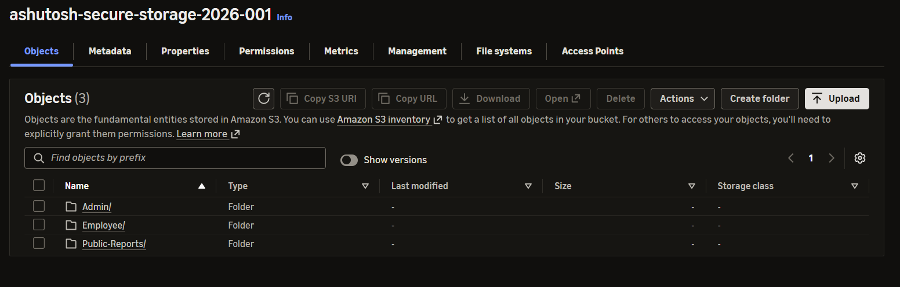
- Bucket versioning
- 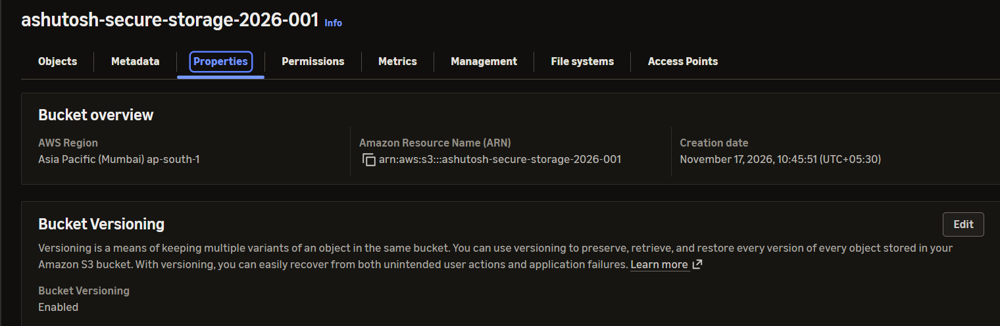
- Default encryption using SSE-S3
- 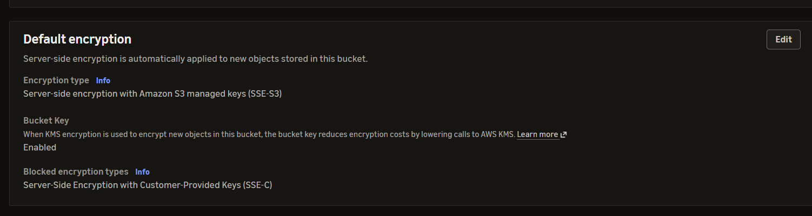
- Block Public Access configuration
- 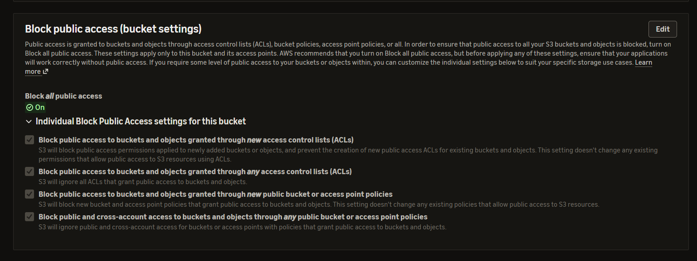

### IAM Access Management
- IAM user groups
- Employee custom IAM policy
- Viewer read-only IAM policy
- User and group assignments

- 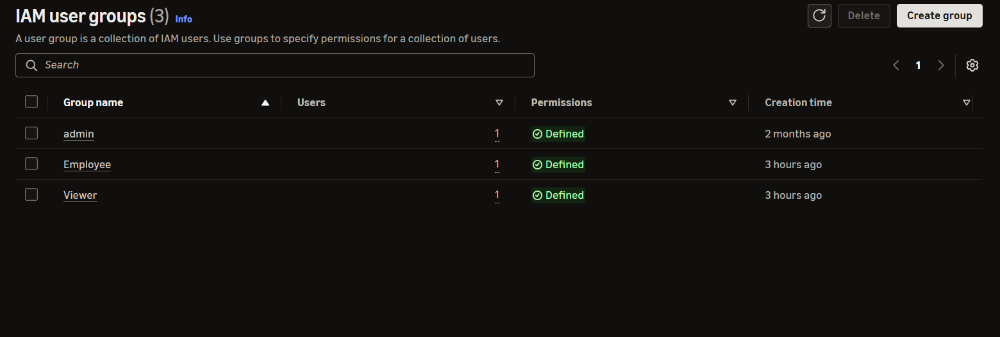

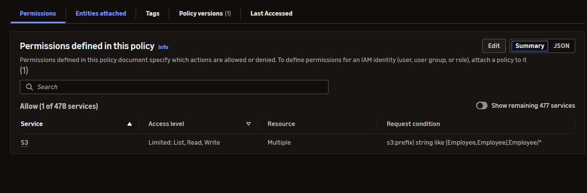

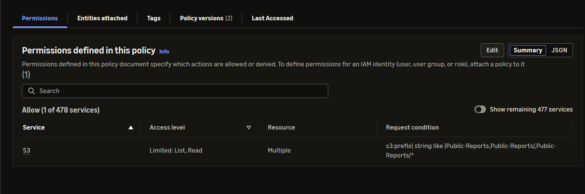

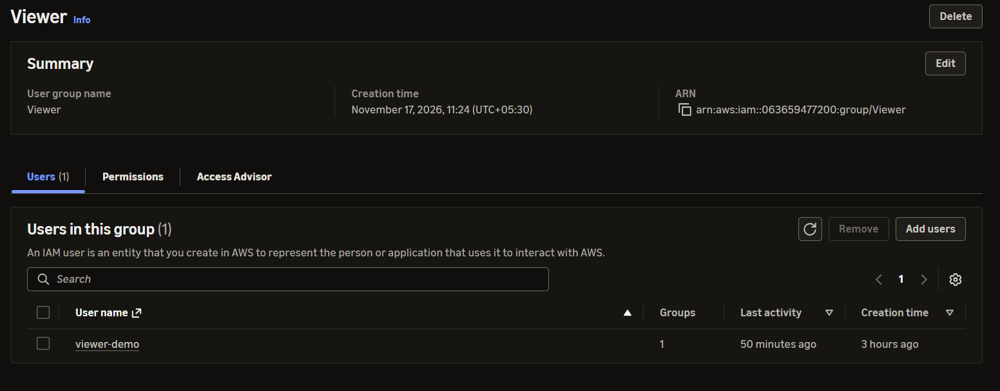

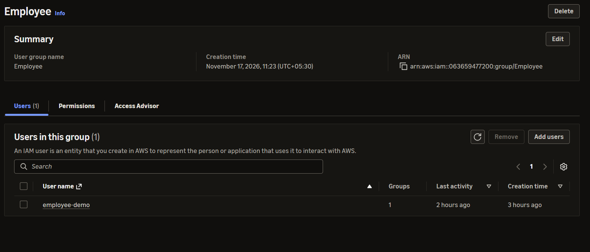

### Employee Access Testing
- Employee folder access
- Successful file upload
- Successful file download
- Unauthorized delete attempt

- 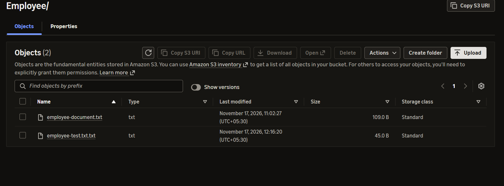

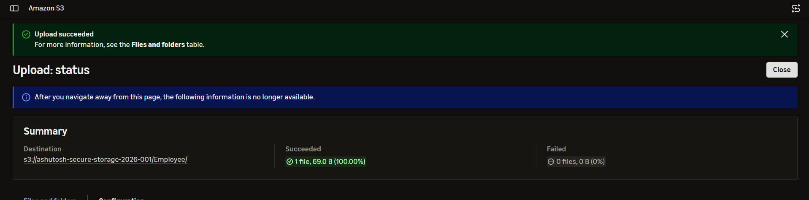

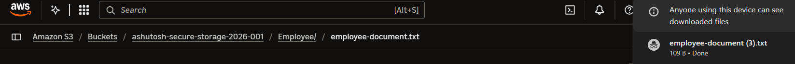

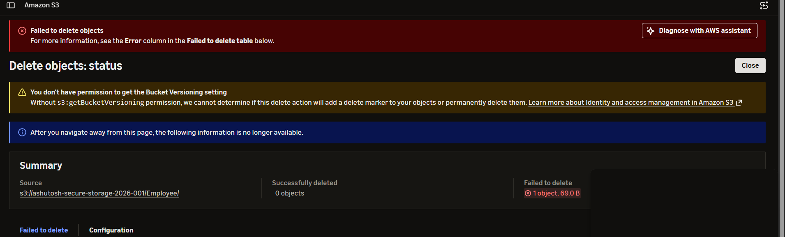

### Viewer Access Testing
- Public-Reports folder access
- Successful report download
- Unauthorized upload attempt
- Restricted access to Admin and Employee folders

- 

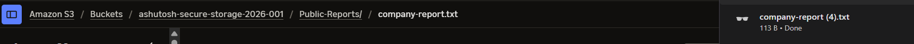

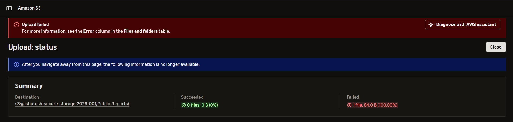

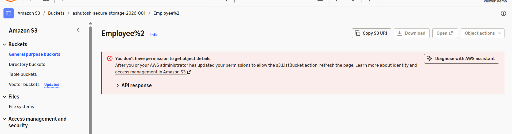

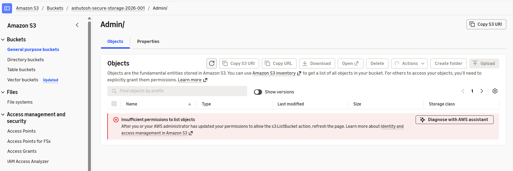

All screenshots are available in the `screenshots/` directory of this repository.
